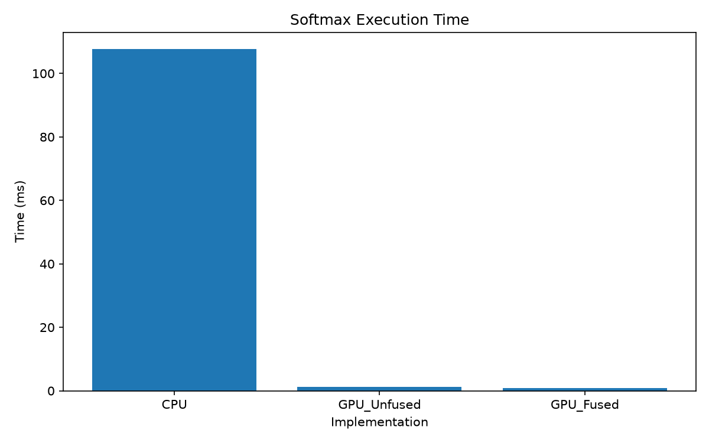
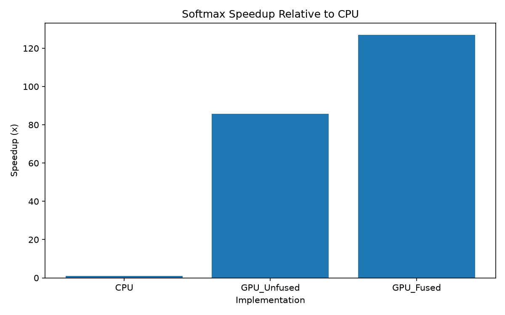

# Softmax and Kernel Fusion using CUDA

## 1. Project Overview

This project implements and compares softmax using a CPU reference and two CUDA GPU implementations:

1. **CPU softmax** — computes softmax on the CPU.
2. **GPU unfused softmax** — computes softmax using three separate CUDA kernel launches.
3. **GPU fused softmax** — combines the softmax stages into one CUDA kernel launch.

The goal is to demonstrate how **kernel fusion** can improve GPU performance by reducing kernel-launch overhead and intermediate data movement.

## 2. Team Members

| Name | USN |
|---|---|
| Abhijit R H | 01FE25BCI709 |
| Sagar P M | 01FE25BCI712 |
| Chaitra V | 01FE25BCI706 |
| Ishani Goudar | 01FE22BCI009 |

## 3. What Is Softmax?

Softmax converts a vector of values into a probability distribution. Each output value is between 0 and 1, and the values in a row sum to approximately 1.

For an input vector `x`, softmax is defined as:

**softmax(xᵢ) = exp(xᵢ) / Σⱼ exp(xⱼ)**

For numerical stability, this project subtracts the maximum value in each row before calculating the exponentials:

**softmax(xᵢ) = exp(xᵢ − m) / Σⱼ exp(xⱼ − m)**

where **m = maxⱼ(xⱼ)**.

Subtracting the same maximum from every value in a row does not change the resulting probabilities, but it helps avoid excessively large exponentials.

## 4. What Is Kernel Fusion?

A CUDA kernel is a function that runs on the GPU. Launching a kernel has overhead, and intermediate results may need to be written to and read from GPU memory.

**Kernel fusion** combines multiple operations into a single kernel. This can reduce the number of launches and the need to store intermediate results in global memory.

In this experiment, the unfused implementation uses three kernels:

1. Find the maximum value in each row.
2. Calculate the sum of exponentials for each row.
3. Normalize each value using that sum.

The fused implementation performs these stages inside one kernel launch. It uses shared memory to reduce values across the threads in a block.

## 5. Project Structure

```text
softmax-kernel-fusion/
├── README.md
├── src/
│   └── softmax_fusion.cu
├── scripts/
│   └── create_graph.py
├── results/
│   └── results.csv
└── graphs/
    ├── softmax_execution_time.png
    └── softmax_speedup.png
```

- `src/` contains the CUDA implementation.
- `scripts/` contains the Python script used to generate graphs.
- `results/` stores the timing data.
- `graphs/` stores the generated visualizations.
- `README.md` documents the project and how to run it.

## 6. Experiment Setup

| Setting | Value |
|---|---|
| GPU | NVIDIA RTX 2050, 4 GB |
| CUDA Toolkit | 13.4 |
| CUDA architecture flag | `sm_86` |
| Input shape | 4096 rows × 1024 columns |
| Data type | 32-bit floating point |

Each row is processed independently. The CUDA implementation launches one thread block per row, with 256 threads per block. Threads process multiple columns when the row has more elements than the block has threads.

## 7. Implementation Details

### CPU reference

The CPU implementation processes each row in three stages:

1. Find the row maximum.
2. Sum the exponentials after subtracting the maximum.
3. Divide each exponential by the sum.

This implementation is used as the reference for checking the GPU outputs.

### GPU unfused implementation

The unfused version launches three separate kernels:

```cpp
row_max_kernel<<<ROWS, THREADS>>>(d_input, d_rowMax, ROWS, COLS);

row_sum_kernel<<<ROWS, THREADS>>>(
    d_input, d_rowMax, d_rowSum, ROWS, COLS);

normalize_kernel<<<ROWS, THREADS>>>(
    d_input, d_rowMax, d_rowSum, d_unfused, ROWS, COLS);
```

The first kernel writes the maximum for each row to `d_rowMax`. The second reads that maximum and writes the sum of exponentials to `d_rowSum`. The third reads those intermediate values and writes the normalized output.

### GPU fused implementation

The fused version performs the same three stages in a single kernel:

```cpp
fused_softmax_kernel<<<ROWS, THREADS>>>(
    d_input, d_fused, ROWS, COLS);
```

Within the kernel, threads first reduce their values to find the row maximum, then reduce the exponentials to find the sum, and finally write the normalized values.

The fused kernel avoids separate launches for the intermediate stages. The maximum and sum are reduced using shared memory within the thread block.

## 8. Build and Run

Run these commands from the project root in the **x64 Native Tools Command Prompt for Visual Studio**.

### Compile the CUDA program

```bat
nvcc -arch=sm_86 src\softmax_fusion.cu -o softmax_fusion.exe
```

This compiles the CUDA source for the RTX 2050's `sm_86` architecture and creates `softmax_fusion.exe`.

### Run the experiment

```bat
softmax_fusion.exe
```

This runs the CPU and GPU implementations, prints execution times and correctness errors, and writes timing data to `results.csv` in the current working directory.

### Generate the graphs

```bat
python scripts\create_graph.py
```

This runs the Python graph-generation script. Run it from the directory containing `results.csv`, or configure the script to read the CSV from `results/`.

## 9. Experimental Results

The following measurements were obtained for an input of 4096 × 1024:

| Implementation | Kernel launches | Execution time |
|---|---:|---:|
| CPU | — | 107.615300 ms |
| GPU unfused | 3 | 1.254400 ms |
| GPU fused | 1 | 0.847872 ms |

### Execution time



Lower execution time indicates better performance.

### Speedup relative to CPU



Higher speedup indicates better performance.

### Interpreting the results

The fused GPU implementation took **0.847872 ms**, compared with **1.254400 ms** for the unfused GPU implementation.

The measured fusion speedup is:

**Fusion speedup = Unfused GPU time / Fused GPU time**

**= 1.254400 / 0.847872 ≈ 1.48×**

The fused version was approximately **32.4% faster** than the unfused version in this run.

The fused GPU time was also approximately **127× lower** than the CPU time for this particular input and implementation. This CPU/GPU comparison is specific to this experiment and should not be treated as a universal performance ratio.

## 10. Correctness Check

The program compares the GPU outputs with the CPU reference by calculating the maximum absolute difference:

**Maximum absolute error = maxᵢ |GPU outputᵢ − CPU outputᵢ|**

The displayed maximum absolute error was `0.000000` for both GPU implementations. This means the differences were zero at the precision printed by the program; it does not necessarily mean the underlying floating-point values are bit-for-bit identical.

## 11. Conclusion

This experiment demonstrates that kernel fusion can improve softmax performance by reducing the number of CUDA kernel launches and avoiding separate intermediate-result buffers for the row maximum and exponential sum.

For the tested input, the fused implementation improved GPU execution time from 1.254400 ms to 0.847872 ms, giving a measured speedup of approximately **1.48×** over the unfused implementation.

The result comes from a single run. GPU timings can vary with system load, clock behavior, and other conditions, so repeated runs and median timings would provide a more reliable performance comparison.

## 12. Technologies Used

- CUDA C++ for GPU programming
- NVIDIA CUDA Toolkit for compilation
- Microsoft Visual C++ Build Tools for the Windows C++ compiler
- Python, pandas, and Matplotlib for reading results and generating graphs
